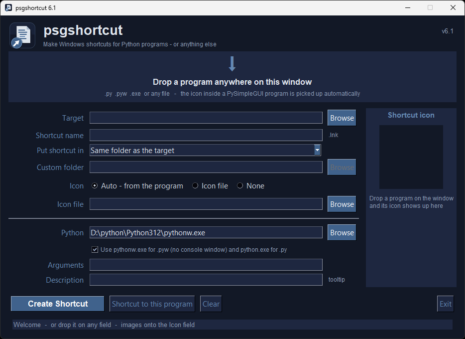

  

  <h2 align="center">psgshortcut</h2>
  <h2 align="center">A PySimpleGUI Application</h2>

PySimpleGUI Shortcut Tool

Creates Windows shortcuts for Python programs (and anything else) - drop the file on the window, click Create Shortcut.

## Features

* **Drag and drop** - drop a `.py`, `.pyw`, `.exe` or any file anywhere on the window
* **Automatic icon** - the icon embedded in a PySimpleGUI program (`ICON = b'iVBORw0KGgo...'`) is found, converted to a `.ico` and used for the shortcut.  Programs without an icon get the PySimpleGUI default icon
* **Icon preview** - see the icon the shortcut will get before you make it; use your own `.ico` / `.png` / `.gif` / `.jpg` instead if you prefer
* **Choose where it goes** - same folder as the program, the Desktop, the Start Menu (so you can pin it to the taskbar) or any folder
* **Pins properly** - the shortcut carries the program's Windows taskbar App ID, so the running window groups under its own pinned icon (works with PySimpleGUI 6.3.17+ and older versions)
* **Right launcher automatically** - `.pyw` files are launched with `pythonw.exe` (no console window), `.py` files with `python.exe`
* **Shortcut name, arguments and description (tooltip)** are all optional
* **Shortcut to this program** - one click fills in a shortcut to psgshortcut itself, so you can pin psgshortcut to your taskbar or Desktop
* Makes shortcuts to EXE and other files too - Windows uses the file's own icon unless you choose another
* Dark HarborMist theme, Escape closes the window, Settings on the right-click menu

## Installation

### Using PIP with PyPI

The latest official release of PySimpleGUI products can be found on PyPI.  To pip install the demo applications from PyPI, use this command

#### If you use the command `python` on your computer to invoke Python (Windows):

`python -m pip install --upgrade psgshortcut`

#### If you use the command `python3` on your computer to invoke Python (Linux, Mac):

`python3 -m pip install --upgrade psgshortcut`

### Using PIP with GitHub

You can also pip install the PySimpleGUI Applications that are in the PySimpleGUI GitHub account.  The GitHub versions have bug fixes and new programs/features that have not yet been released to PyPI. To directly pip install from that repo:

#### If you use the command `python` on your computer to invoke Python (Windows):

`python -m pip install --upgrade https://github.com/PySimpleGUI/psgshortcut/zipball/main`

#### If you use the command `python3` on your computer to invoke Python (Linux, Mac):

`python3 -m pip install --upgrade https://github.com/PySimpleGUI/psgshortcut/zipball/main`

### Requirements

Installed automatically by pip: `PySimpleGUI`, `pywin32` (writes the `.lnk` files), `psgdnd` (drag and drop) and `pillow` (makes the `.ico` files).
psgshortcut still runs if `psgdnd` or `pillow` are missing - you just lose drag and drop, or icon conversion.

## Usage

Once installed, launch psgshortcut by typing the following in your command line:

`psgshortcut`

You can also pass a file:  `psgshortcut my_program.pyw` pre-fills the target.

1. Drop your program on the window (or click Browse)
2. Check the icon in the preview, pick where the shortcut should go
3. Click **Create Shortcut** (or press Enter)

The shortcut is a normal Windows `.lnk` file - move it anywhere, double-click it, or pin it to the taskbar.

## Make a Shortcut To This Program

Click **Shortcut to this program**.  The form is filled in with psgshortcut itself (icon included), pick a destination and click **Create Shortcut**.  Put it on your Desktop or in the Start Menu and pin it from there - no command window needed.

## Make Shortcuts To Anything

You can not only make shortcuts to Python programs, but you can make shortcuts to EXE and other files.  Drop the file on the window, click **Create Shortcut** and you'll find the shortcut in the folder you chose.

## Pinning To The Taskbar

Windows will only pin shortcuts whose target is an EXE, which is why Python shortcuts are made with `pythonw.exe` (or `python.exe`) as the target and your program as the argument - the **Python** field shows which one will be used.  Put the shortcut in the **Start Menu** or on the **Desktop**, then right-click it → *Pin to taskbar*.

For the running program to group under its pinned icon (instead of opening a second, generic Python icon) the shortcut must carry the same taskbar App ID the program sets.  psgshortcut writes the `.lnk` with `IShellLink` + `IPropertyStore` and sets `System.AppUserModel.ID` to:

* `PySimpleGUI.App.<md5 of the script path>` for programs run with PySimpleGUI 6.3.17 or newer (the ID PySimpleGUI derives from the script path - psgshortcut asks the interpreter in the **Python** field which version it has)
* `mycompany.myproduct.subproduct.version` for programs run with an older PySimpleGUI
* whatever the program passes to `sg.set_options(win_app_id=...)`, if it does
* no ID for programs that don't use PySimpleGUI

## Where the Icons Go

The `.ico` files made from your programs' embedded icons are saved next to the program (`my_program.pyw` → `my_program.ico`).  Right-click → **Settings** can send them to one central folder (`%LOCALAPPDATA%\psgshortcut\icons`) instead if you prefer to keep program folders clean.

## License & Copyright

Copyright 2023-2026 PySimpleGUI.

Licensed under LGPL3.

## Contributing

I'm happy to receive issues describing bug reports and feature
requests! The project does not accept pull requests.  

